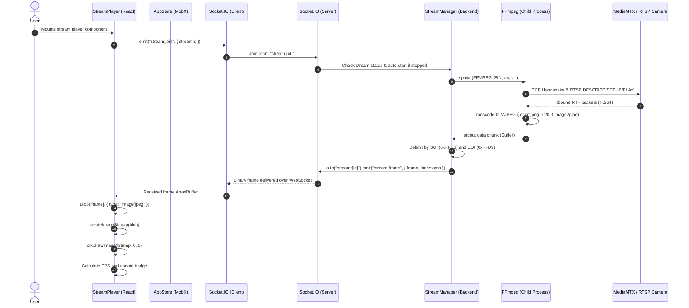

# Application Architecture

## 1. High-Level Architecture Overview

The system consists of three distinct tiers:
1. **Frontend Client**: Single-Page Application (SPA) built with **React 19**, **Vite**, and **MobX**, responsible for UI layout, state synchronization, canvas rendering, and user controls.
2. **Backend Server**: **Node.js** and **Express** service managing REST endpoints, in-memory stream metadata, Socket.IO real-time channels, and child process lifecycle for **FFmpeg**.
3. **Stream Generation & Ingestion (Local Testing)**: Standalone **Docker Compose** environment orchestrating a **MediaMTX** RTSP/HLS relay server and three **FFmpeg** synthetic video publishing containers.

```mermaid
flowchart TB
    subgraph Client ["Client (React 19 + MobX + Canvas)"]
        UI[UI Components / Grid]
        Store[AppStore (MobX Singleton)]
        APIClient[Axios API Client]
        SocketClient[Socket.IO Client]
        Canvas[HTML5 Canvas Player]
    end

    subgraph Server ["Backend (Node.js + Express + Socket.IO)"]
        ExpressApp[Express REST API]
        StreamRoutes["/api/streams & /api/health"]
        SocketServer[Socket.IO Server]
        StreamMgr[StreamManager Service]
        FFmpegProcess[FFmpeg Child Process - spawn]
    end

    subgraph StreamingRelay ["Streaming Infrastructure (Docker Compose)"]
        MediaMTX["MediaMTX Server (:8554 RTSP, :8888 HLS)"]
        FFmpegFeed1["FFmpeg Earth Loop"]
        FFmpegFeed2["FFmpeg Road Loop"]
        FFmpegFeed3["FFmpeg Plant Loop"]
    end

    subgraph ExternalSources ["External Feeds"]
        IPCam["Physical IP Cameras / External RTSP Feeds"]
    end

    %% Client - Server Communication
    UI --> Store
    Store --> APIClient
    Store --> SocketClient
    APIClient -->|HTTP REST: CRUD & Controls| ExpressApp
    SocketClient <-->|WebSocket: Events & Status| SocketServer
    SocketServer -->|Binary MJPEG Frames| Canvas

    %% Server Internal
    ExpressApp --> StreamRoutes
    StreamRoutes --> StreamMgr
    SocketServer --> StreamMgr
    StreamMgr -->|Spawns & Monitors| FFmpegProcess

    %% Ingestion
    FFmpegFeed1 -->|RTSP Push| MediaMTX
    FFmpegFeed2 -->|RTSP Push| MediaMTX
    FFmpegFeed3 -->|RTSP Push| MediaMTX
    IPCam -.->|RTSP Pull| FFmpegProcess
    MediaMTX -->|RTSP Pull| FFmpegProcess
```

---

## 2. Component Structure & Directory Layout

### Frontend (`/client`)
- [`client/src/main.tsx`](file:///w:/shubham/personal/RTSP-Video-Stream-Viewer/client/src/main.tsx): Client bootstrap into DOM.
- [`client/src/App.tsx`](file:///w:/shubham/personal/RTSP-Video-Stream-Viewer/client/src/App.tsx): Root application layout; toggles theme class and renders Topbar, Sidebar, MainContent, and AddStreamModal.
- [`client/src/store/AppStore.ts`](file:///w:/shubham/personal/RTSP-Video-Stream-Viewer/client/src/store/AppStore.ts): Central MobX singleton managing streams list, UI active tab, modal visibility, and theme state. Initializes socket listeners and triggers REST actions.
- [`client/src/constants/presets.ts`](file:///w:/shubham/personal/RTSP-Video-Stream-Viewer/client/src/constants/presets.ts): Default preset streams for testing with MediaMTX.
- [`client/src/utils/`](file:///w:/shubham/personal/RTSP-Video-Stream-Viewer/client/src/utils/):
  - `error.ts`: `extractErrorMessage` utility for consistent Axios error message extraction.
  - `url.ts`: `isValidStreamUrl` validation helper for protocol checks (`rtsp://`, `rtsps://`, `http://`, `https://`).
- [`client/src/components/layout/`](file:///w:/shubham/personal/RTSP-Video-Stream-Viewer/client/src/components/layout/):
  - `Topbar.tsx`: Branding and theme toggle (Dark/Light).
  - `Sidebar.tsx`: Stream tab filters (`active` vs `all`) and list of `StreamCard` items.
  - `MainContent.tsx`: Dynamic player grid adapting classes `players-grid--1` or `players-grid--2` based on count of active displayed streams.
- [`client/src/components/StreamCard/StreamCard.tsx`](file:///w:/shubham/personal/RTSP-Video-Stream-Viewer/client/src/components/StreamCard/StreamCard.tsx): Sidebar item displaying stream name, URL, live status badge, and activation/deletion triggers.
- [`client/src/components/StreamPlayer/StreamPlayer.tsx`](file:///w:/shubham/personal/RTSP-Video-Stream-Viewer/client/src/components/StreamPlayer/StreamPlayer.tsx): Live video player component. Subscribes to Socket.IO room `stream:${id}`, decodes incoming binary JPEG chunks using `createImageBitmap` (or `Image()` fallback), draws frames to HTML `<canvas>`, and computes real-time FPS.
- [`client/src/components/AddStreamModal/AddStreamModal.tsx`](file:///w:/shubham/personal/RTSP-Video-Stream-Viewer/client/src/components/AddStreamModal/AddStreamModal.tsx): Dual-column modal: left column offers quick-add presets (`DEFAULT_STREAMS`); right column contains a custom RTSP form with credentials extraction/formatting.
- [`client/src/services/`](file:///w:/shubham/personal/RTSP-Video-Stream-Viewer/client/src/services/):
  - `api.ts`: Axios client configured with base URL, timeout, and interceptors.
  - `apiHandler.ts`: Typed API helper functions for streams and health checks.
  - `socketService.ts`: Socket.IO client singleton factory (`getSocket()`).
- [`client/src/config/env.ts`](file:///w:/shubham/personal/RTSP-Video-Stream-Viewer/client/src/config/env.ts): Client configuration reading `VITE_API_URL` and `VITE_WS_URL`.
- [`client/Dockerfile`](file:///w:/shubham/personal/RTSP-Video-Stream-Viewer/client/Dockerfile): Multi-stage container definition compiling the React application with `node:20-alpine` and serving the production bundle with `serve` on port 5001.

### Backend (`/server`)
- [`server/src/index.ts`](file:///w:/shubham/personal/RTSP-Video-Stream-Viewer/server/src/index.ts): Initializes Express, HTTP server, CORS policies, Socket.IO instance, route mounting, security and logging middleware, and process signal handlers (`SIGINT`, `SIGTERM`).
- [`server/src/routes/health.ts`](file:///w:/shubham/personal/RTSP-Video-Stream-Viewer/server/src/routes/health.ts): Health endpoint returning process uptime and timestamp.
- [`server/src/routes/streams.ts`](file:///w:/shubham/personal/RTSP-Video-Stream-Viewer/server/src/routes/streams.ts): REST endpoints for stream CRUD and play/pause controls.
- [`server/src/services/logger.ts`](file:///w:/shubham/personal/RTSP-Video-Stream-Viewer/server/src/services/logger.ts): Enterprise Winston logger with daily file rotation (`winston-daily-rotate-file`), console colorization, credential redaction (`sanitize()`), HTTP request logging middleware (`requestLoggerMiddleware`), and log protection middleware (`protectLogsMiddleware`).
- [`server/src/services/streamManager.ts`](file:///w:/shubham/personal/RTSP-Video-Stream-Viewer/server/src/services/streamManager.ts): Core streaming orchestrator. Manages `Map<string, StreamItem>` and `Map<string, ActiveProcess>`, executes FFmpeg child processes, splits stdout into discrete JPEG frames, and dispatches frames/status to Socket.IO rooms.
- [`server/src/services/socketService.ts`](file:///w:/shubham/personal/RTSP-Video-Stream-Viewer/server/src/services/socketService.ts): Sets up Socket.IO events (`stream:join`, `stream:leave`, `stream:start`, `stream:stop`, `ping`).
- [`server/src/types/stream.ts`](file:///w:/shubham/personal/RTSP-Video-Stream-Viewer/server/src/types/stream.ts): Backend TypeScript interfaces (`StreamItem`, `StreamStatus`, `CreateStreamDto`, `UpdateStreamDto`).

### CI/CD & Cloud Deployment (`/.github/workflows`)
- [`.github/workflows/aws-deploy-client.yml`](file:///w:/shubham/personal/RTSP-Video-Stream-Viewer/.github/workflows/aws-deploy-client.yml): Automated GitHub Actions pipeline triggered via `workflow_dispatch` to build the client Docker image, publish to Amazon ECR, and deploy to an AWS EC2 instance via SSH.

### Streaming Ingestion (`/custom-video-streamer`)
- [`custom-video-streamer/docker-compose.yml`](file:///w:/shubham/personal/RTSP-Video-Stream-Viewer/custom-video-streamer/docker-compose.yml): Runs `mediamtx` container and 3 FFmpeg containers (`ffmpeg-earth`, `ffmpeg-road-and-trees`, `ffmpeg-watering-plant`).
- [`custom-video-streamer/mediamtx/mediamtx.yml`](file:///w:/shubham/personal/RTSP-Video-Stream-Viewer/custom-video-streamer/mediamtx/mediamtx.yml): MediaMTX configuration setting internal users (`viewer`, `publisher`, `apiuser`) and configuring RTSP (8554), HLS (8888), and REST API (9997).

---

## 3. Detailed Data Flow: RTSP to Browser Canvas



### Frame Demuxing Algorithm Details
In [`server/src/services/streamManager.ts`](file:///w:/shubham/personal/RTSP-Video-Stream-Viewer/server/src/services/streamManager.ts#L183-L235):
1. FFmpeg is executed with:
   `-i <url> -an -c:v mjpeg -q:v 4 -r 20 -f image2pipe -`
2. `child.stdout` yields partial binary chunks.
3. Node maintains a rolling `frameBuffer`.
4. It identifies standard JPEG markers:
   - Start of Image (SOI): `0xFF 0xD8`
   - End of Image (EOI): `0xFF 0xD9`
5. Upon locating both markers, the buffer slice between SOI and EOI + 2 is sliced as a standalone valid JPEG file.
6. The completed JPEG frame Buffer is immediately emitted via Socket.IO to the room `stream:${id}`.
7. Memory leak guard: If `frameBuffer` exceeds 4 MB without discovering an EOI (corrupt stream), it is flushed to empty.

---

## 4. External Integrations & System Boundaries

| Boundary | Interface | Protocol | Port / Location | Description |
|---|---|---|---|---|
| **Client ↔ Server (REST)** | HTTP JSON | HTTP/1.1 | `4000` (or `VITE_API_URL`) | Stream CRUD and server lifecycle control |
| **Client ↔ Server (WS)** | Socket.IO Engine | WebSocket / Polling | `4000` (or `VITE_WS_URL`) | Real-time binary frames and status messages |
| **Server ↔ Transcoder** | Process Standard I/O | OS Pipe (`spawn`) | Internal | Node.js spawns FFmpeg binary and reads stdout |
| **Transcoder ↔ RTSP Server** | Network Stream | RTSP over TCP | `8554` (Default MediaMTX) | FFmpeg consumes remote or local video feeds |
| **Local Test Streamer** | Docker Compose | Docker Bridge Network | `8554` (RTSP), `8888` (HLS), `9997` (API) | MediaMTX relay with 3 infinite loop FFmpeg feeds |
| **Client Deployment (Cloud)** | Docker Container on EC2 | HTTP | `5001` (Container) / Host Port | Client app compiled and served via Docker on AWS EC2 |

---

## 5. Architectural Trade-Offs & Decisions

1. **MJPEG over WebSocket vs. HLS vs. WebRTC**:
   - *Choice*: MJPEG over WebSockets rendered to HTML5 `<canvas>`.
   - *Advantage*: Zero client-side HLS segment latency; straightforward implementation without requiring ICE/STUN/TURN signaling servers (WebRTC) or complicated HLS segmenters.
   - *Disadvantage*: MJPEG transfers each frame as an independent compressed JPEG, resulting in higher bandwidth consumption than inter-frame compressed video (H.264/H.265) and omitting native browser audio support.
2. **In-Memory State**:
   - *Choice*: In-memory `Map` in backend and MobX store in client.
   - *Advantage*: Instant startup, zero database dependencies, optimal for evaluation and testing.
   - *Disadvantage*: Server restarts lose all registered user streams.
3. **Dual Sync (REST + WebSockets)**:
   - *Choice*: REST API is used for standard mutations (`POST`, `PATCH`, `DELETE`); WebSockets are used for frame streaming and broadcast updates.
   - *Advantage*: Standard HTTP error codes for clients, while keeping high-throughput binary streaming off HTTP polling.

