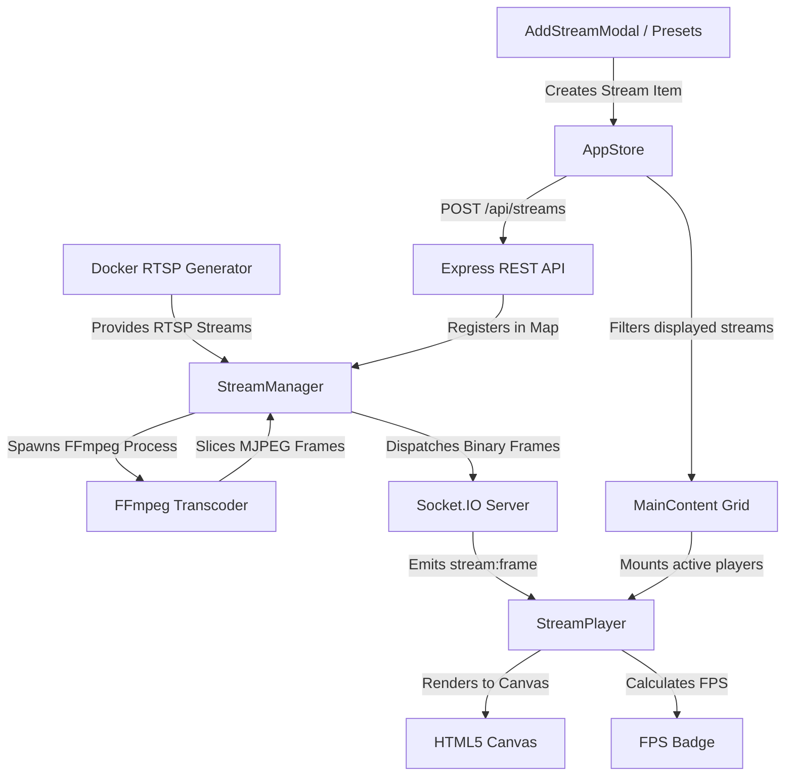

# Feature Inventory & Implementation Map

## 1. Feature Map

| Feature | Primary Location | Key Dependencies | Status |
|---|---|---|---|
| **Stream Registry (CRUD)** | Backend: [`server/src/routes/streams.ts`](file:///w:/shubham/personal/RTSP-Video-Stream-Viewer/server/src/routes/streams.ts) Frontend: [`client/src/store/AppStore.ts`](file:///w:/shubham/personal/RTSP-Video-Stream-Viewer/client/src/store/AppStore.ts) | Express, Axios, MobX | Complete (In-memory) |
| **FFmpeg RTSP Transcoding** | Backend: [`server/src/services/streamManager.ts`](file:///w:/shubham/personal/RTSP-Video-Stream-Viewer/server/src/services/streamManager.ts) | `ffmpeg-static`, `child_process.spawn` | Complete |
| **WebSocket Binary Streaming** | Backend: [`server/src/services/socketService.ts`](file:///w:/shubham/personal/RTSP-Video-Stream-Viewer/server/src/services/socketService.ts) Frontend: [`client/src/services/socketService.ts`](file:///w:/shubham/personal/RTSP-Video-Stream-Viewer/client/src/services/socketService.ts) | `socket.io`, `socket.io-client` | Complete |
| **Canvas Video Player** | Frontend: [`client/src/components/StreamPlayer/StreamPlayer.tsx`](file:///w:/shubham/personal/RTSP-Video-Stream-Viewer/client/src/components/StreamPlayer/StreamPlayer.tsx) | HTML5 Canvas, `createImageBitmap` | Complete |
| **Live Framerate Counter (FPS)** | Frontend: [`client/src/components/StreamPlayer/StreamPlayer.tsx`](file:///w:/shubham/personal/RTSP-Video-Stream-Viewer/client/src/components/StreamPlayer/StreamPlayer.tsx#L47-L54) | React `useRef`, `useState` | Complete |
| **Player Action Controls** | Frontend: [`client/src/components/StreamPlayer/StreamPlayer.tsx`](file:///w:/shubham/personal/RTSP-Video-Stream-Viewer/client/src/components/StreamPlayer/StreamPlayer.tsx#L195-L267) | Fullscreen API, PiP API (`captureStream`), MobX | Complete |
| **Dynamic Responsive Grid** | Frontend: [`client/src/components/layout/MainContent.tsx`](file:///w:/shubham/personal/RTSP-Video-Stream-Viewer/client/src/components/layout/MainContent.tsx) | CSS Grid (`players-grid--1`, `players-grid--2`) | Complete |
| **Add / Edit Stream Modal** | Frontend: [`client/src/components/AddStreamModal/AddStreamModal.tsx`](file:///w:/shubham/personal/RTSP-Video-Stream-Viewer/client/src/components/AddStreamModal/AddStreamModal.tsx) | MobX, React forms | Complete |
| **Pre-Configured Test Presets** | Frontend: [`client/src/components/AddStreamModal/AddStreamModal.tsx`](file:///w:/shubham/personal/RTSP-Video-Stream-Viewer/client/src/components/AddStreamModal/AddStreamModal.tsx#L12-L28) | Docker MediaMTX | Complete |
| **Sidebar Stream Filtering** | Frontend: [`client/src/components/layout/Sidebar.tsx`](file:///w:/shubham/personal/RTSP-Video-Stream-Viewer/client/src/components/layout/Sidebar.tsx) | MobX computed `listedStreams` | Complete |
| **Dark / Light Theme Toggle** | Frontend: [`client/src/components/layout/Topbar.tsx`](file:///w:/shubham/personal/RTSP-Video-Stream-Viewer/client/src/components/layout/Topbar.tsx) [`client/src/App.css`](file:///w:/shubham/personal/RTSP-Video-Stream-Viewer/client/src/App.css) | MobX `dark` observable | Complete |
| **Synthetic RTSP Video Streamer** | Ingestion: [`custom-video-streamer/docker-compose.yml`](file:///w:/shubham/personal/RTSP-Video-Stream-Viewer/custom-video-streamer/docker-compose.yml) | Docker, MediaMTX, LinuxServer FFmpeg | Complete |
| **Server Health Monitoring** | Backend: [`server/src/routes/health.ts`](file:///w:/shubham/personal/RTSP-Video-Stream-Viewer/server/src/routes/health.ts) | Express Router | Complete |
| **Structured Winston Logging & Rotation** | Backend: [`server/src/services/logger.ts`](file:///w:/shubham/personal/RTSP-Video-Stream-Viewer/server/src/services/logger.ts) | `winston`, `winston-daily-rotate-file` | Complete |
| **HTTP Request & Security Middleware** | Backend: [`server/src/services/logger.ts`](file:///w:/shubham/personal/RTSP-Video-Stream-Viewer/server/src/services/logger.ts) [`server/src/index.ts`](file:///w:/shubham/personal/RTSP-Video-Stream-Viewer/server/src/index.ts) | Express Middleware | Complete |
| **Client Dockerization & AWS CI/CD** | Infrastructure: [`client/Dockerfile`](file:///w:/shubham/personal/RTSP-Video-Stream-Viewer/client/Dockerfile) [`.github/workflows/aws-deploy-client.yml`](file:///w:/shubham/personal/RTSP-Video-Stream-Viewer/.github/workflows/aws-deploy-client.yml) | Docker, GitHub Actions, AWS ECR/EC2 | Complete |
| **Client Error & URL Validation Helpers** | Frontend: [`client/src/utils/error.ts`](file:///w:/shubham/personal/RTSP-Video-Stream-Viewer/client/src/utils/error.ts) [`client/src/utils/url.ts`](file:///w:/shubham/personal/RTSP-Video-Stream-Viewer/client/src/utils/url.ts) | TypeScript | Complete |

---

## 2. Feature Interdependencies

- **Playback depends on Transcoding**: `StreamPlayer` cannot display video unless `StreamManager` successfully spawns FFmpeg and demuxes JPEG frames without syntax errors or connection drops.
- **Player Grid depends on MobX State**: `MainContent` dynamically toggles between single-camera full-width (`players-grid--1`) and dual-column grid (`players-grid--2`) purely based on `appStore.displayedStreams.length`.
- **Presets depend on Docker Containers**: The preconfigured options in `AddStreamModal` (`earth`, `road_and_trees`, `watering_plant`) require `custom-video-streamer` containers to be running; otherwise, connection errors occur and display in the UI.

---

## 3. Technical Debt & Feature Gaps

1. **Audio Support**:
   - The current transcoding pipeline explicitly strips audio (`-an`) because MJPEG does not support audio multiplexing. To support audio, WebRTC or segmented fMP4/HLS must be implemented.
2. **Bandwidth Optimization**:
   - MJPEG streams individual JPEG images at 20 FPS (approx. 500 KB/s - 2 MB/s per stream). For multiple streams, this exerts substantial network load compared to H.264/WebRTC.
3. **Stream Auto-Recovery**:
   - If an RTSP camera disconnects or drops connection, FFmpeg exits. While error status is dispatched to the client (`stream:error`), there is currently no automatic retry/backoff mechanism in `StreamManager`. The user must manually click "Reconnect Stream".
4. **Recording / Archival**:
   - Video is strictly streamed live to volatile sockets; no disk recording or DVR snapshot features exist yet.

